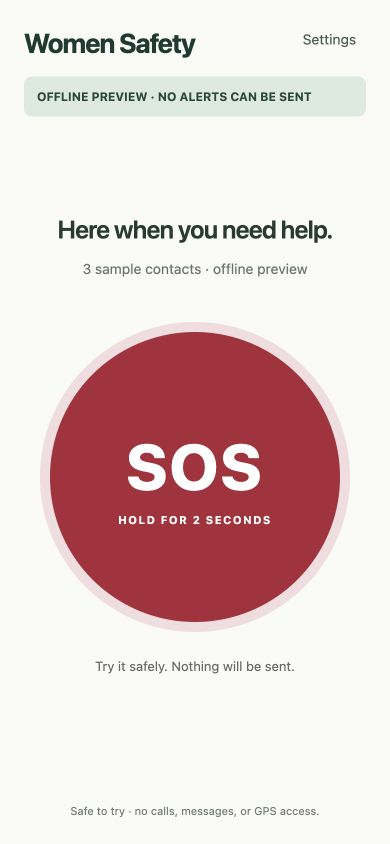

# Women Safety Software

One button to ask your chosen people for help, with SMS and WhatsApp alerts containing coordinates, a map link, and a private live-location link.

**Android + iOS · Version 0.4.1 · early development · test mode by default.** This is a working open-source foundation, not a validated emergency-response product. Real SMS requires a configured provider. Police notification requires a consenting agency integration; the repository does not connect to police stations or India's 112 service out of the box.

Builds and installation: [iOS downloads and installation without the App Store](docs/IOS.md) · [Android installation](docs/INSTALLING.md). iPhone installation requires Apple signing; simulator builds and unsigned IPA files are labelled separately.


## What is implemented

- Android/iOS app built with React Native and Expo, with a a large SOS button after setup: hold for two seconds to activate.
- One to six configurable, consenting contacts with international phone-number validation.
- A local Pipecat voice prototype with local Whisper/Piper speech options and constrained, factual responses. No telephone calls are enabled.
- An optional operator-configured reverse geocoder for approximate place names.
- An SOS is created immediately without waiting for GPS. The same link then receives location updates.
- Background location task for development/standalone builds, plus foreground tracking and retry of the latest fix.
- Persistent, encrypted backend storage and an outbox that submits contact alerts concurrently.
- Twilio SMS and WhatsApp template adapters, with independent per-contact/channel statuses. Both carry coordinates, maps links, and the private tracking link; a single coordinate follow-up is sent if GPS arrives after the first alert. Test mode makes no provider calls.
- Private, random 256-bit location links, a timestamp and accuracy for each fix, stale-location warnings, 24-hour expiry, and revocation when sharing ends.
- Optional police-partner registry: select the nearest consenting, configured station within its service radius and submit an authenticated webhook with the live link. HTTP acceptance is never represented as police dispatch.
- Idempotent SOS retries; duplicate taps do not create duplicate active incidents. An unconfirmed request is saved on the phone; it retries only after a deliberate activation in the current session. Reopening the app or returning from the background requires a fresh hold to resume it.

This first release is **one owner per self-hosted backend**, paired using an operator-generated token. It does not yet provide public sign-up, multiple user accounts, verified contact onboarding, or a managed hosted service.

## Safe phone preview

The home screen has one large SOS button. Hold it for two seconds; short taps and opening the app do not send an alert. First-run setup asks you to choose up to six contacts (native picker or manual entry), then offers location, background sharing, and optional evidence permissions directly. Later, edit these under Settings. See [phone installation](docs/INSTALLING.md) and the [engineering safety review](docs/SAFETY_REVIEW.md). The offline preview cannot send messages or access GPS.



## Run the backend

Requires Node.js 24+ (uses built-in SQLite). There are no backend npm dependencies.

```sh
git clone https://github.com/sharvinhariharan-hub/women-safety-software.git
cd women-safety-software
npm run setup
npm start
```

`setup` creates a git-ignored `.env` with random `OWNER_TOKEN` and `DATA_KEY`, and keeps any existing `.env` intact. View the file privately to obtain the pairing token. Never paste it into issues, screenshots, or emergency messages.

The default server is `http://localhost:8080`, listening only on loopback. `GET /health` checks that it is running. Tests use disposable local servers and never send emergency texts.

```sh
npm test
```

For a physical phone, expose the backend through your own HTTPS endpoint. Set `PUBLIC_URL` to that externally reachable origin; location links must resolve for recipients, not just on your development laptop. Set `HOST=0.0.0.0` only when deliberately binding to your development network or container. Never expose plain HTTP with real tokens or personal information. A phone's `localhost` points to the phone, not your laptop.

## Run the mobile app

```sh
cd mobile
npm ci
npx expo run:android
# Or, on macOS with Xcode and iOS build tooling:
npx expo run:ios
```

These commands build a native development app. Android requires the Android SDK/emulator or a connected phone; iOS requires Xcode. Background location must be tested in a native development/standalone build, **not Expo Go**. Production binaries and app-store distribution are not included in this release. The default identifiers in `app.json` are placeholders; replace them with identifiers you control before distribution.

1. Enter your backend's HTTPS origin and private owner token.
2. Add your name and one to six contacts who agreed to receive SOS messages.
3. Save the profile and grant foreground location access during setup.
4. Optionally enable background location before an emergency. Operating-system indicators and Android's foreground-service notification may be visible.
5. Select SMS, WhatsApp, or both for each contact, then hold **SOS** for two seconds. In test mode, every job explicitly says **Test only · nothing sent**.
6. Inspect delivery states and location freshness. **End location sharing** revokes the link. It cannot recall texts or cancel an emergency response.

If location access is denied, the alert still starts and the tracking page says that location is unavailable. If the server is unreachable, the app clearly states that the alert is unconfirmed and retries with the same request ID while open. It does not claim to send SMS through a phone with no internet.

## Configure real SMS

Create/configure a Twilio messaging account and an SMS-capable sender. Provider costs, verified destinations on trial accounts, geographic permissions, sender registration, and local messaging requirements are the operator's responsibility. No messaging account or paid resource is provisioned by this repository.

Set these values privately in `.env`:

```dotenv
ALERT_MODE=live
PUBLIC_URL=https://your-safety-server.example
TWILIO_ACCOUNT_SID=your_account_sid
TWILIO_AUTH_TOKEN=your_private_auth_token
TWILIO_FROM=your_SMS_capable_international_number
```

Restart the server. A submission to Twilio is displayed as `submitted`, not `delivered`; the worker polls submitted message status every 30 seconds. This does not prove the human read the message. HTTP/network ambiguity is displayed as `unknown` and is not automatically retried because doing so can duplicate a message already accepted by the provider.

## WhatsApp, coordinates, and Pipecat

See [SMS and WhatsApp configuration](docs/MESSAGING.md) for the approved eight-variable WhatsApp template, sender configuration, snapshot/follow-up behavior, and optional place-name lookup. New contacts default to both channels; contacts saved before this update remain SMS-only until the owner opts them into WhatsApp.

See [Pipecat voice prototype](voice_agent/README.md) for free local conversation testing and optional local speech. Pipecat is installed and tested as a real pipeline. It is not connected to a telephone carrier or police call centre, and it does not place calls. The software remains free/open source; external messaging, carrier, and hosting operation can incur costs.

## Police and support organisations

Support organisations can be selected as contacts only if they agree to receive these messages. A publicly listed police phone number or map pin does **not** establish a monitored emergency integration.

See [police integration](docs/POLICE_INTEGRATION.md) for the operator-maintained registry and webhook contract. With no registry, the app says police are not connected. The nearest **configured partner** is not necessarily the nearest real police station. This project does not claim a public police/112 API exists.

## Architecture and API

```text
Mobile SOS → authenticated backend → encrypted incident + persistent outbox
                                  ├─ parallel SMS → private tracking link
Mobile GPS → authenticated update ├─ latest location → recipient page
                                  └─ optional consenting police webhook
```

- `GET /api/status` — mode, configuration, profile, and active incident.
- `PUT /api/profile` — configure the owner and up to six contacts.
- `POST /api/incidents` — create/recover an SOS using a UUID `requestId`; optional `location`.
- `GET /api/incidents/:id` — individual job statuses for the owner.
- `PUT /api/incidents/:id/location` — latitude, longitude, accuracy in metres, timestamp in epoch milliseconds.
- `GET /api/incidents/:id/voice-brief` — authenticated, expiring incident facts for Pipecat, with no contacts or share token.
- `POST /api/incidents/:id/end` — revoke sharing and cancel jobs not yet submitted.
- `GET /api/shared` — private recipient read using `X-Share-Token`; no contacts or owner credentials returned.
- `/track#<share-token>` — recipient page, polling every five seconds. The fragment is immediately removed from the address bar and sent in a header. Refreshing the page requires reopening the original message link.

All owner API routes require `Authorization: Bearer <OWNER_TOKEN>`. This is a single-owner deployment, not a multi-tenant authentication system. No third-party map or analytics requests happen automatically; recipients may explicitly open the latest coordinate in Google Maps.

## Privacy and current limits

Profiles, locations, private link tokens, and message payloads are encrypted with AES-256-GCM before SQLite storage. The server can decrypt them; this is **not end-to-end encryption**. Keep `DATA_KEY` separate from database backups. Mobile pairing credentials, pending SOS IDs, and the latest fix use OS-backed secure storage. The owner profile remains stored until the operator removes it; incidents and their jobs are purged 24 hours after their 24-hour sharing expiry. SQLite deletion is logical deletion, not a promise of forensic erasure from disks or backups.

Anyone holding a private location link can view it until sharing ends or expires. No login is required for recipients in this version. A compromised owner token controls the whole deployment: rotate it and re-pair the phone if exposed. No actual user details or credentials are included in source.

There is no guaranteed one-minute delivery or response time. Carrier delays, lost connectivity, device shutdown, OS task termination, battery restrictions, permission changes, and unavailable location services can interrupt the flow. App-initiated SOS currently requires opening the app; lock-screen activation, voice/impact triggers, and physical accessories are outside this version. No telephone calls, audible alarms, or automatic recording are made. Optional video with audio requires explicit camera/microphone grants and an explicit recording action during an active SOS; it is limited to two minutes/50 MiB per clip. Clips are stored in the app’s private document directory, can be exported/deleted from Saved recordings, and are never attached to alerts or private links. OS/device backups may include app data, and uninstalling the app deletes local clips. Recording requires the installed Android/iOS app in the foreground; physical-device capture is not yet validated. The optional local voice prototype uses a microphone only in the explicitly started browser test.

Additional work before a public safety deployment: physical-device validation, contact verification and opt-out flows, human acknowledgement/escalation, abuse controls for multiple accounts, monitored operations, independent security/accessibility review, and an agreed emergency-service integration.

## Development and verification

```sh
npm test
npm run check:mobile
cd mobile
npm run lint
npx expo install --check
npx expo export --platform android --platform ios
npm audit
```

See [the safety review](docs/SAFETY_REVIEW.md) for the verified boundaries and [phone installation](docs/INSTALLING.md) for offline previews.

The repository includes CI for backend tests, mobile TypeScript and lint, dependency compatibility, and both platform bundles. The scoped `@expo/fingerprint` minimatch override selects a patched release for an upstream tooling dependency.

Backend tests cover authentication, input validation, duplicate requests, concurrency, partial failures, uncertain delivery, restart recovery, location freshness, link expiry/revocation, police opt-in, and retention. Bundle/type checks do not validate native permissions, locked-screen tracking, real SMS/WhatsApp delivery, police response, or battery behavior. See [device test plan](docs/DEVICE_TEST_PLAN.md).

References: [Expo Location](https://docs.expo.dev/versions/latest/sdk/location/), [Expo TaskManager](https://docs.expo.dev/versions/latest/sdk/task-manager/), [Expo SecureStore](https://docs.expo.dev/versions/latest/sdk/securestore/), [Twilio messages API](https://www.twilio.com/docs/messaging/api/message-resource), [India's ERSS overview](https://www.mha.gov.in/emergency-response-support-system-erss).

## Contributing

See [CONTRIBUTING.md](CONTRIBUTING.md). Please use fictional test identities and numbers in issues and fixtures. Do not test by contacting emergency services without prior coordination.

## License

MIT — see [LICENSE](LICENSE).
